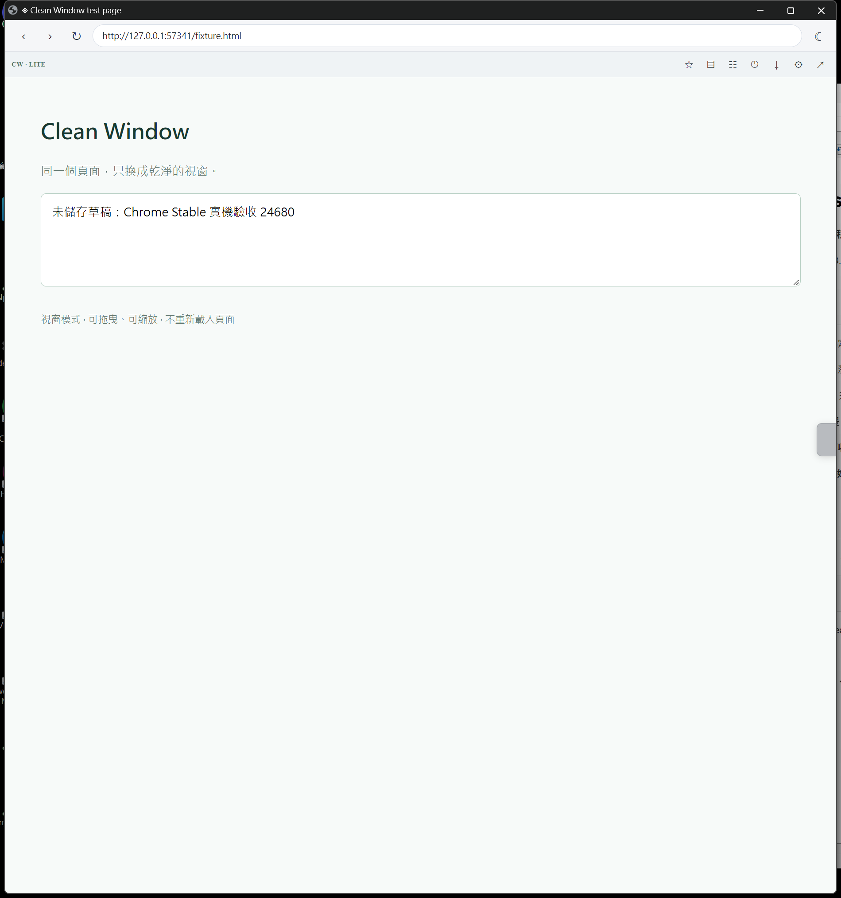

# Verification record

Publication baseline: **2026-09-23 (Asia/Taipei)**. Version: **0.1.0 source preview**.

## Current local verification — 2026-10-26

Current acceptance update adds the optional Windows Chrome Stable GUI harness and verifies all four shortcuts through OS-level keyboard input. Runtime fixes remain unchanged from `8cf37b0`; native popup/titlebar evidence was recorded at `63c7697`. This follow-up adds test tooling and documentation only.

- `npm test`: **PASS, 95/95** simulated Chrome API and Popup tests. Coverage includes missing/unverifiable session journals, safe restore fallback, and keeping recovery metadata out of persistent local storage.
- `npm run check`: **PASS**, including JavaScript/MV3 static checks, required/optional permission boundaries and Runtime source/version validation.
- `npm run build:runtime`: **PASS**; 20 files copied into `dist/runtime/`, and `dist/clean-window-v0.1.0.zip` was generated and verified (64,243 bytes).
- `npm run smoke:dom`: **PASS**; the drawn-bar suite now checks bounded toolbar-host repair (two automatic retries, then clean fallback), no duplicate layout padding, explicit reapply, level-2 overlay repair, and rejection of plain search text/unsafe schemes without navigation. Existing cross-origin allow/deny/cancel flows, YouTube layouts, SPA/fullscreen transitions and AI workspace viewport checks also pass.
- `tests/browser-smoke.py`: **PASS, 10 headed-browser checks; SKIP, 2** in Playwright-managed Chrome for Testing 156.0.8078.4 with an isolated temporary profile. The latest run loaded the generated `dist/runtime/` directory (not the source tree). Verified MV3 service worker/action panel load, all four default shortcuts registered through `chrome.commands.getAll()` (`Alt+Shift+Y`, `Alt+Shift+F`, `Alt+Shift+U`, `Alt+Shift+J`), same-tab/page-state preservation, isolation of a second window, restore, fullscreen bounds, maximized-state restoration, metadata-free fallback and stale-target rejection.
- The prior defaults `Alt+Shift+W`, `Alt+Shift+R` and `Alt+Shift+T` were not registered by the isolated Chrome for Testing build. Defaults are now `Alt+Shift+Y`, `Alt+Shift+U` and `Alt+Shift+J`; all four commands, including unchanged fullscreen `Alt+Shift+F`, are registered. Playwright page-level keyboard events cannot reliably synthesize browser-chrome Commands API input. The Windows GUI harness below uses pywinauto/Win32 OS-level keyboard input instead. Native desktop screenshot capture in the Playwright run was skipped because Chrome API bounds can differ from physical pixels under DPI scaling; the separate Windows GUI harness captures the native popup.
- Chrome Stable 156.0.8078.48 ignored `--disable-extensions-except`; the runtime was therefore loaded through the official `chrome://extensions` → Developer mode → Load unpacked UI in an isolated temporary profile. Verified Clean Window 0.1.0 enabled, all four default shortcuts registered, and `toggle-clean` created a real Chrome Stable `type: popup` window. The level-1 toolbar injected; the original tab ID, page session token, unsaved textarea contents and sibling tab were preserved. Restore returned the same tab to its original normal window. Windows UI Automation confirmed native minimize/maximize/close titlebar buttons, and the captured screenshot is included below. No browser policy was modified and no personal Chrome profile was used. Real-site state retention beyond the local fixture and physical multi-monitor/DPI transitions remain incomplete. `git diff --check`: **PASS**.



## Windows Chrome Stable keyboard acceptance — 2026-10-26

- `tests/windows-chrome-gui-smoke.py`: **PASS** on Chrome Stable 156.0.8078.48 with an isolated temporary profile and `dist/runtime/`. The harness loaded the extension through the official UI, checked `chrome.commands.getAll()`, and sent OS-level keyboard input using pywinauto/Win32. All four shortcuts dispatched successfully: `Alt+Shift+Y` created a clean Popup and injected the level-1 toolbar; `Alt+Shift+J` opened the title editor only while the tab was in the managed Popup; `Alt+Shift+U` restored the same tab, closed the title editor, and preserved the page session token and unsaved textarea content; `Alt+Shift+F` entered and exited fullscreen. A sibling tab remained in the original window. The script terminated its isolated Chrome process and removed its temporary profile.
- This validates Windows OS-level synthetic keyboard dispatch, not a physical keyboard hardware press. It does not validate signed-in AI websites, real-site form/media behavior, incognito, physical multi-monitor/DPI transitions, Windows Snap or PWA/app windows.

## Final three-mode contract — 2026-10-22

- **MODE1 (`address-dock`)**: the full 86px two-row URL + extension toolbar is visible immediately and never collapses. Ordinary pages reserve 86px; AI chat workspaces retain their app-owned root layout.
- **MODE2 (`address-hidden`)**: a 48px URL-only bar starts collapsed behind a 76×6px top-center handle. Hover or keyboard focus reveals it; it never reserves page space and has no extension dock.
- **MODE3 (`off`)**: no page-top URL bar or toolbar. The controller clears an existing bar without injecting page UI solely to hide it; the independent edge mode/restore control remains separate.
- YouTube level 1 shifts the native layout below the persistent toolbar. Level 2 uses an effective toolbar height of 0 while collapsed and its rendered height while revealed; level 3 keeps the full-viewport player without a top bar.
- Popup mode labels and preview artwork now match this contract. Chrome Headless regression coverage verifies all three modes and the YouTube layout transitions.

## Level 1 UI reconciliation — 2026-10-22

- `controller.run('set-level')` no longer treats a matching session-journal level as proof that the injected UI is correct. Reapplying a selected level now restores the matching page toolbar and edge rail.
- Clicking the already-selected edge stop now sends a reconciliation request instead of silently doing nothing. This provides a recovery path if level 1's two-row toolbar has drifted to level 2's URL-only interface.
- Regression tests simulate the journal saying level 1 while the page UI is in address-only mode, then verify selecting level 1 restores `address-dock`. Chrome Headless DOM verifies a repeated click sends a controller request.

## Cross-origin navigation and YouTube positioning — 2026-10-22

- Added `optional_host_permissions` for HTTP(S) only; these are not granted at installation. A cross-origin URL submitted in the drawn address bar opens an extension-owned choice page that requests only the target hostname after an explicit click. HTTPS targets request HTTPS; HTTP targets request both schemes for that hostname to handle common upgrades.
- Approval navigates the original managed tab and allows `tabs.onUpdated` to reattach the drawn UI. Declining permission requires a separate explicit choice to continue; Cancel leaves the source page in place. Same-origin navigation remains immediate and does not prompt.
- Cross-origin links or redirects without a prior host grant can still remove injected controls. The new `reapply-clean` context-menu action requests reinjection through a user-initiated `activeTab` grant without persistent host access.
- Pending destination URLs are kept only in `chrome.storage.session` while the choice is pending; tests cover cancellation, denial, timeout-on-next-access, target/prompt window closure, unsafe URLs, untrusted senders, unrelated-tab isolation, HTTP-to-HTTPS upgrades and keeping incognito prompts in the matching context.
- `npm test`: **92/92 PASS**. `npm run check`: **PASS**. `npm run smoke:dom`: **PASS**, including same-origin/cross-origin address-bar flow, permission-page allow/deny/cancel, fallback choice UI and YouTube layout regressions.
- YouTube Focus View is now a featured README demo; the existing level-2 page-preserving and level-3 player-focused behavior is retained.
- **REMAINING:** the permission request UI and full navigation/reattachment flow have not yet been accepted in an installed MV3 extension on a live Chrome profile. Headless DOM tests use bounded API stubs; they do not prove the real Chrome permission prompt or native window behavior.

## Three-level update — developed 2026-10-12, committed 2026-10-17

The three selectable popup modes are drawn address+extension dock, address only and bare popup. The extension dock offers only Clean Window Restore and Chrome extension-management shortcuts. Previous DOM focus-masking experiment is retired. Verified on the local Windows device: 46/46 simulated-API and popup interaction tests PASS; JavaScript/MV3 static checks PASS; 3/3 isolated Chrome Dev Headless DOM checks PASS; Git diff whitespace checks PASS. Live Chrome extension installation, native popup visual appearance, and extension-dock actions remain NOT YET GUI-VERIFIED.

## Editable title update — 2026-10-17 (feature branch)

A document-scoped title controller initializes the original webpage title with a Unicode Symbol prefix and supports a transient editor (shortcut and page context menu), a custom title and glyph, SPA title updates, reset and restore. Its title text is neither uploaded nor persisted. Level 3 still works when injection is blocked, but title editing is then unavailable. The native OS popup titlebar and favicon rendering are **not** verified by Headless DOM tests.

Local verification: **52/52** Node API/popup tests, **7/7** isolated Chrome Dev Headless DOM checks, MV3 static checks and Git whitespace checks PASS.

## Popup layout and edge-control update — 2026-10-17 (feature branch)

The primary Apply action moved above the level picker. A draggable icon-only edge tab supplies three in-page levels without recreating the popup. Isolated Chrome Dev Headless DOM tests cover hover visibility, level selection, drag and local position persistence. Native Chrome popup rendering, real extension installation and cross-origin reattachment remain unverified.

Windows local checks: **62/62** simulated API/popup tests PASS; `npm run check`, `npm run smoke:dom` and Git whitespace checks PASS before commit.

## Emoji title and missing edge-control fix — 2026-10-18

Fixed edge host positioning where `all:initial!important` took precedence over non-important `top/left/right`. Fixed hover rail pointer hit-testing, and prepared edge content script before moving the tab into a Popup. Reuses existing content scripts when possible to avoid a second post-move `activeTab` injection request. Single-click edge handle sends an authenticated title-edit action; drags do not open it. Emoji validation uses grapheme segmentation to support ZWJ, skin-tone and flag Emoji while rejecting multiple independent icons.

Isolated Chrome Headless DOM checks cover pointer clicks, right/left viewport alignment, drag and click separation, and Emoji editing. These are not acceptance of a live MV3 extension on the user's active Chrome profile.

## Level-1 lightweight toolbar and managed-window list — 2026-10-18

The final three-mode contract uses an 86px always-visible two-row toolbar for level 1, a 48px URL-only bar collapsed by default for level 2, and no page-top URL bar or toolbar for level 3. The level-1 toolbar provides authenticated session-scoped window management, Restore, bookmark permission entry, local recent bookmarks, and Chrome history/download/extension-management shortcuts. The extension popup has a collapsible managed-window list. Bookmark access is optional, explicitly granted on a separate extension page. No broad host, `tabs`, `management`, or downloads/history permissions were introduced. Session storage caches a display title only for managed popups and revalidates tab-window relationships.

At the 2026-10-18 checkpoint, **68/68** simulated API/popup tests and **15/15** isolated Chrome Dev Headless DOM checks passed, along with `npm run check`. Actual installed MV3 extension interaction, permission prompt, Chrome native popup appearance, and source-window recovery still required GUI acceptance.

## Evidence levels

| Check | Result | Scope |
| --- | --- | --- |
| `npm test` | PASS, 95/95 | Windows / Node.js 24.4.1; simulated Chrome APIs and Popup interactions |
| `npm run check` | PASS | JavaScript syntax, MV3 metadata, matching versions, minimal permissions, unique default shortcuts, icons and inline-handler checks |
| GitHub CI | PASS, run #14 | [Runtime baseline run](https://github.com/pingqLIN/clean-window/actions/runs/40217092996) for commit `63c7697`; this follow-up changes only test tooling and documentation, not Runtime code |
| Headed Chromium acceptance | PASS, 10 checks / 2 skipped | Playwright-managed Chrome for Testing 156.0.8078.4; isolated temporary profile. Skips: native desktop screenshot and physical keyboard invocation |
| Windows Chrome GUI acceptance | PASS, isolated Chrome Stable | Manually loaded `dist/runtime/` through the official extension UI; verified native Popup/titlebar, level-1 toolbar injection, same-tab restore, unsaved page-state preservation and sibling-tab isolation |
| Windows OS-level shortcut acceptance | PASS, 4/4 commands | `tests/windows-chrome-gui-smoke.py` uses pywinauto/Win32 keyboard input. Toggle, title editor, restore and fullscreen enter/exit passed; physical keyboard hardware is not separately tested |
| Hero image | Concept art only | Not evidence of Chrome rendering or successful installation |

The original extension runtime files were preserved for publication. Public documentation was reorganized, private-path-bearing development logs and internal delivery plans were excluded, and CI plus original banner artwork were added.

## Automated coverage

The current 95 automated tests cover target-only effects, same-tab moves, origin restoration, missing origin and last-tab fallback, maximized/fullscreen round trips, stale and changing targets, operation locking, grouped/Split View guards, storage/API failures, usable fallback windows, worker reconstruction, interrupted journaling, incognito separation, message-source validation, cleanup isolation, level-2 cross-origin URL-bar permission gating, level-3 no-toolbar fallback, pending-navigation cleanup and temporary reapplication.

## Re-run the accepted checks

```sh
npm test
npm run check
npm run smoke:dom
```

No npm installation is required. Tests use Node's built-in test runner. Raw local logs belong in ignored `evidence/` or `local/` directories rather than public Git history.

## Optional headed browser test

`tests/browser-smoke.py` is a Linux-oriented developer tool requiring Python, Playwright, Pillow, a compatible Chromium executable, Xvfb, and Openbox. Read the script and use an isolated disposable test environment. Its startup flags include `--no-sandbox`; do not use it to browse untrusted sites or with a personal profile. It serves only synthetic loopback fixtures and must not be used to bypass managed-browser policy.

The script is not included in required CI; the recorded run passed 10 checks and skipped 2 (native desktop screenshot capture and physical keyboard hardware input).

## Optional Windows GUI acceptance

`tests/windows-chrome-gui-smoke.py` requires Windows, installed Chrome Stable, Python, `playwright`, `pywinauto` and `pywin32`. Build Runtime first with `npm run build:runtime`, then run `python tests/windows-chrome-gui-smoke.py`. It uses an isolated temporary profile, loads `dist/runtime/` through Chrome's extension UI, serves only a local synthetic fixture and sends OS-level keyboard events. The latest run passed all four shortcut commands, title editing, restore, fullscreen enter/exit, unsaved-state preservation and sibling-tab isolation. It is optional and not part of CI; it does not test physical keyboard hardware or signed-in websites. If policy blocks unpacked extensions, stop without attempting to bypass it.

## Remaining acceptance

Still verify signed-in Gemini, Claude and ChatGPT sidebars/input/attachments, real-site forms and media, incognito boundaries, physical multi-monitor/DPI transitions, Windows Snap, and special browser/PWA pages. Physical keyboard hardware presses are not separately tested; OS-level shortcut dispatch is covered by the Windows GUI harness. Follow [the safe first-check procedure](usage.md#install-and-first-check).

No independent second-person security review has been completed. Automated coverage does not establish security, UI appearance, or real-site state preservation.

## Edge mode preview verification — 2026-10-21

- Chrome DOM tests use trusted CDP mouse/key events on the production edge script and a synthetic YouTube fixture. Verified 150ms hover activation, distinct preview/committed selection, no background mode commands or local-storage writes during hover, and reuse of the same video element.
- Verified live-player animation and uniform horizontal/vertical scale, leave/Escape restoration including scroll position, level-1 toolbar preview, rapid target replacement, click committing once, failed-commit rollback, reduced-motion behavior, navigation/resize cancellation and cleanup during Restore.
- Regression: preview feedback originally enlarged the rail and moved the target away from the pointer. Feedback now sits outside the rail flow; the test confirms that the original pointer coordinates still hit the same mode button after preview activation.
- Regression: scrollbar changes can fire visual-viewport resize events. Those must not cancel preview; actual window resize and pinch-scale changes cancel it instead.
- INCOMPLETE: new hover previews and transitions have not been accepted in the installed extension on a live YouTube stream or across physical monitors. Earlier live mode-switching results below apply to committed layouts, not this new preview feature.
- 繁中驗證摘要：隔離 Chrome 已驗證預覽不儲存、過渡等比例、移出／Esc 還原、點擊確認、失敗回復及各項取消流程；提示文字不再推移按鈕。新預覽尚待已安裝擴充中的真實 YouTube 與實體多螢幕驗收。

## YouTube layout verification — 2026-10-20

- `npm test`: 77 tests passed. `npm run check`: passed with no manifest permission changes.
- `npm run smoke:dom`: passed, including actual Chrome CSS geometry for level 3 viewport fit/resize, level 2 normal/theater player height and preserved comment colors/scrolling, level 1/Restore cleanup, SPA routes, native fullscreen state transitions and lookalike-host rejection.
- The YouTube smoke fixture uses the production script and synthetic website DOM in an isolated temporary Chrome profile. It does not load the real MV3 extension or a signed-in YouTube session.
- A later live YouTube level-2 inspection reproduced metadata/recommendations overlapping the video: the outer `#full-bleed-container` retained its native height while the inner player grew. The absolutely positioned `ytd-app` also bypassed the drawn toolbar's root padding. Both cases now have a failing-then-passing Chrome fixture regression.
- The same scoped CSS correction was applied to the current live document and visually checked. Player top and drawn toolbar bottom both measured 48 CSS px; player bottom and following content top both measured 871 CSS px. Playback continued. Temporary screenshots remain outside the repository.
- Adaptive sizing regression: changing the rendered toolbar to 72px updates both player offset and height; hiding it reserves no space. Chrome emulation covers 640×720 at DPR 1, 1440×900 at DPR 1.5 and 1920×1080 at DPR 2. These are viewport/device-metric simulations, not physical monitor transitions or actual browser zoom acceptance.
- Follow-up mode distinction: level 2 uses aspect-based player height capped by available viewport height, keeping native page content visible. Level 3 hides non-player website descendants and explicitly retains the player subtree, preventing native sibling stacking contexts from painting metadata/recommendations above the video. Chrome regressions cover both theater and normal player placement.
- Live current-document verification: level 2 measured a player at (0,48), 1183×665.4375 CSS px, with following page content starting at 713.4375 and visible. A trusted hover/click on the extension's actual edge rail switched to level 3: player (0,0), 1198×874, matching the viewport; page content hidden, video visible, playback continued. Screenshots were inspected. The separate temporary correction style was absent during this check.
- INCOMPLETE: a controlled full-extension reload, complete level-1/Restore acceptance and physical monitor/browser-zoom transitions remain unverified. Earlier temporary DevTools demonstrations are separate evidence.
- 本次通過 77 項測試、靜態檢查與隔離 Chrome 版面測試；真實 YouTube 已驗證第二模式保留頁面內容，並透過實際側邊控制器切換第三模式，確認影片滿版且其餘網站內容隱藏、持續播放。受控的完整擴充重載、第一模式／還原及實體跨螢幕驗收仍未完成。未變更 manifest 權限。
